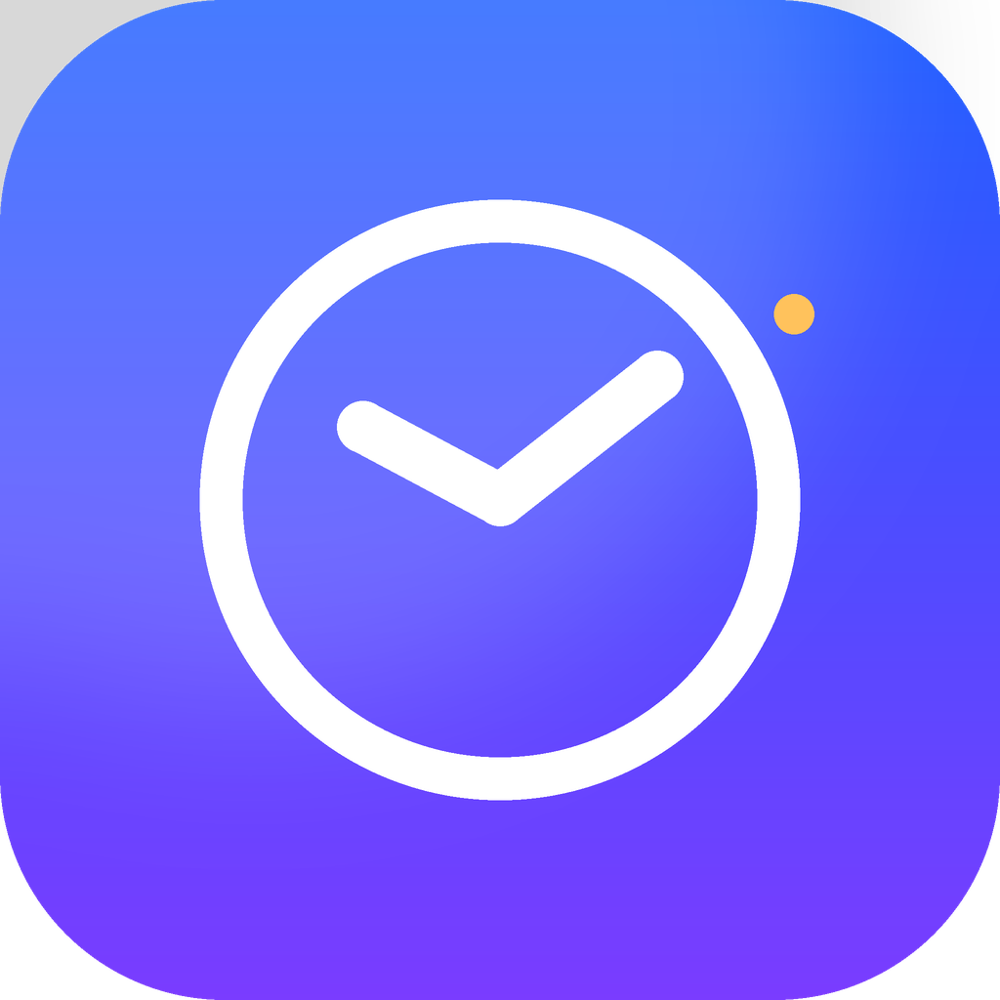

# ZoneFlip

> 菜单栏一键切换 macOS 系统时区：**中国 ⇄ 美国**。
> One-click macOS menu bar timezone switcher for **China ⇄ US**.

[中文](#中文) · [English](#english)



## 中文

挂美国 IP 时点一下变成美西时间，不用了点一下回到中国；也可以打开「跟随出口 IP」全自动切换。

- 原生 AppKit，无 Electron、无后台常驻进程、无账号、无遥测。
- 只改 macOS 的系统时区（`/etc/localtime`），浏览器、日历、Git、Claude Code 看到的时间会一起变。
- 免密助手只接受 5 个固定时区参数，装一次之后切换零弹窗。

### 下载即用

不想装 Xcode、不想编译，直接用打包好的 universal 版本（Apple Silicon + Intel，macOS 11+）：

1. 到 [Releases](https://github.com/fanxuejun0906-create/zoneflip/releases/latest) 下载 `ZoneFlip.zip`，解压
2. 把 `ZoneFlip.app` 拖进「应用程序」
3. 首次打开被 Gatekeeper 拦下时：**系统设置 → 隐私与安全性 → 仍要打开**

或者一行命令完成下载、安装、去隔离并启动：

```bash
curl -fsSL https://raw.githubusercontent.com/fanxuejun0906-create/zoneflip/main/scripts/remote-install.sh | bash
```

> App 没有 Apple 开发者签名和公证（那需要付费账号），浏览器下载的包首次会被系统拦一次；用上面的命令或「仍要打开」即可，之后正常双击。

### 从源码安装

```bash
git clone https://github.com/fanxuejun0906-create/zoneflip.git
cd zoneflip
bash scripts/install.sh
```

脚本会编译、安装到 `/Applications/ZoneFlip.app` 并启动。首次启动时菜单栏会出现 `🇨🇳 11:53` 这样的时间。

也可以自己构建后手动拖进「应用程序」：

```bash
bash scripts/build.sh      # 产物在 dist/ZoneFlip.app
```

要求：macOS 11+。构建脚本会同时产出 Apple Silicon 和 Intel，合成一个 universal App。

### 用法

点菜单栏时间：

| 菜单项 | 作用 |
|---|---|
| **回到中国时区 / 切换到美国西部时间** | 主按钮，按当前状态自动变成另一个方向 |
| **选择美国时区** | 西部、东部、中部、山地，记住上次选择 |
| **跟随出口 IP 自动切换** | 每 5 分钟跟随出口国家：US → 对应美国时区，CN → 中国时区，其它国家不动 |
| **立即检测出口 IP** | 手动查一次，不切换 |
| **开机自动启动** | 写入 `~/Library/LaunchAgents/com.jennie.zoneflip.plist` |
| **安装免密助手** | 输一次管理员密码，之后切换不再弹框 |
| **打开「日期与时间」设置** | 需要手动改其它时区时用 |

切换时区是全局的：所有 App、浏览器 `Intl`、命令行 `date` 都会跟着变。

### 关于「自动设置时区」

macOS 的「自动设置时区」开着时，系统会按定位把时区改回去。所以：

- 切到**美国**时，ZoneFlip 会顺手关掉「自动设置时区」，保证不被系统抢回去。
- 切回**中国**时，会重新打开它，恢复 macOS 的默认行为。

### 免密助手的安全边界

macOS 不允许普通 App 改系统时区。不想每次都输密码，就需要一次授权。ZoneFlip 的做法是装一个**只做一件事**的 root 脚本：

```
/usr/local/libexec/zoneflip-tz        # root:wheel 0755，约 60 行 bash
/etc/sudoers.d/zoneflip               # 只允许 admin 组免密执行这个脚本的固定参数
```

- 脚本只认识 `cn / us-west / us-east / us-central / us-mountain / auto-on / auto-off / status`，其它参数直接 `exit 64`。
- 每个参数对应**硬编码**的 IANA 时区，不拼接、不 eval 用户输入。
- sudoers 规则逐条列出「脚本 + 参数」，不是通配符，不能借此执行任意命令。
- 想撤销：`sudo rm /usr/local/libexec/zoneflip-tz /etc/sudoers.d/zoneflip`，或菜单里「卸载免密助手」。
- 不装也能用，只是每次切换会弹一次管理员密码框。

### 自动跟随的实现

打开「跟随出口 IP 自动切换」后，App 每 5 分钟（以及唤醒时）请求一次 `https://ipinfo.io/json`，只读取 `country` / `timezone` 两个字段：

- `US` → 按 IP 时区选美西 / 美东 / 美中 / 山地
- `CN` → `Asia/Shanghai`
- 其它国家 → 保持不动

不出网的数据只有这次请求本身，没有账号、没有标识符、没有本地历史。不想联网就只用手动切换，功能完全不受影响。

### 命令行

```bash
/Applications/ZoneFlip.app/Contents/MacOS/ZoneFlip --diagnose
/Applications/ZoneFlip.app/Contents/MacOS/ZoneFlip --set us-west
/Applications/ZoneFlip.app/Contents/MacOS/ZoneFlip --set cn
/Applications/ZoneFlip.app/Contents/MacOS/ZoneFlip --dump-menu
```

`--diagnose` 会打印当前时区、助手状态、登录项状态；输出同时写到 `~/Library/Application Support/ZoneFlip/cli.log` 和 `/tmp/zoneflip-cli.log`。

### 卸载

```bash
bash scripts/uninstall.sh
```

会删除 App、免密助手、sudoers 规则、登录项和日志；**不会**改回你当前的系统时区。

### 项目结构

```
Sources/
  main.swift            启动、CLI、菜单自检
  AppDelegate.swift     菜单栏 UI 与菜单逻辑
  ZoneController.swift  时区读写、助手调用、登录项
  IPLocator.swift       ipinfo.io 查询
  Shell.swift           Process 封装
helper/
  zoneflip-tz           root 助手脚本
  zoneflip.sudoers      sudoers 规则
Resources/Info.plist
scripts/build.sh        swiftc 编译 + 组装 .app
scripts/install.sh      构建 + 安装到 /Applications
scripts/remote-install.sh  一行命令安装最新 Release
scripts/uninstall.sh
scripts/make_icon.py    生成 AppIcon.icns
```

自己改了代码后重新跑 `bash scripts/install.sh` 即可覆盖安装（会先退出旧进程）。

## English

ZoneFlip is a tiny native macOS menu bar app that flips the **system time zone** between China and the US. Keep it on `Asia/Shanghai` normally; when you are browsing through a US IP, click once and the whole Mac — browser, calendar, shell, Claude Code — reports US time. Click again to go back.

### Features

- Menu bar clock with a flag: `🇨🇳 11:53` / `🇺🇸 20:53`.
- One click switches between `Asia/Shanghai` and US West / East / Central / Mountain (remembers the last US zone).
- Optional **Follow exit IP**: polls `ipinfo.io` every 5 minutes; a US exit selects the matching US zone, a CN exit switches back to China, other countries leave the zone alone.
- **Passwordless helper**: install once (one admin prompt), then switches never prompt again.
- Turns macOS "Set time zone automatically" **off** while on a US zone (so Location Services cannot fight it) and **on** again when switching back to China.
- Launch at login toggle. No account, no telemetry, no background daemon.

### Download & run

No Xcode, no build step — grab the universal build (Apple Silicon + Intel, macOS 11+):

1. Download `ZoneFlip.zip` from [Releases](https://github.com/fanxuejun0906-create/zoneflip/releases/latest) and unzip it
2. Drag `ZoneFlip.app` into `/Applications`
3. If Gatekeeper blocks the first launch: **System Settings → Privacy & Security → Open Anyway**

Or do download + install + de-quarantine + launch in one line:

```bash
curl -fsSL https://raw.githubusercontent.com/fanxuejun0906-create/zoneflip/main/scripts/remote-install.sh | bash
```

> The app is ad-hoc signed, not notarized (that requires a paid Apple Developer account), so a browser-downloaded copy triggers Gatekeeper once. The command above or "Open Anyway" gets you past it; later launches are normal.

### Build from source

```bash
git clone https://github.com/fanxuejun0906-create/zoneflip.git
cd zoneflip
bash scripts/install.sh
```

It builds with `swiftc`, installs to `/Applications/ZoneFlip.app` and launches it. Requirements: macOS 11+. The build script produces a universal binary (Apple Silicon + Intel).

To build without installing: `bash scripts/build.sh` → `dist/ZoneFlip.app`.

### Usage

Click the menu bar clock:

| Item | What it does |
|---|---|
| **Back to China / Switch to US West** | Primary toggle, label follows the current state |
| **Choose US zone** | West, East, Central, Mountain — remembers your choice |
| **Follow exit IP** | Automatic switching between CN and US based on the exit country |
| **Check exit IP now** | One lookup, no switching |
| **Launch at login** | Writes `~/Library/LaunchAgents/com.jennie.zoneflip.plist` |
| **Install passwordless helper** | One admin prompt, then no more dialogs |
| **Open Date & Time settings** | For switching to any other zone manually |

The change is system-wide: every app, `Intl` in the browser and `date` in the shell follow it.

### Passwordless helper

Changing the system zone requires root. ZoneFlip installs two small, auditable pieces:

```
/usr/local/libexec/zoneflip-tz   # root:wheel 0755, ~60 lines of bash
/etc/sudoers.d/zoneflip          # lets the admin group run ONLY this script with fixed arguments
```

The helper accepts exactly `cn`, `us-west`, `us-east`, `us-central`, `us-mountain`, `auto-on`, `auto-off`, `status`; every argument maps to a hard-coded IANA zone, and anything else exits with code 64. The sudoers entry lists each command + argument explicitly — no wildcards, no arbitrary command execution. Remove it any time from the menu or with `sudo rm /usr/local/libexec/zoneflip-tz /etc/sudoers.d/zoneflip`. Without the helper the app still works, it just asks for an admin password on every switch.

### Uninstall

```bash
bash scripts/uninstall.sh
```

Removes the app, the helper, the sudoers rule, the login item and logs. It leaves your current system time zone untouched.

### Notes

- The app is an ad-hoc signed local build (no notarization). Builds made on your own Mac run without Gatekeeper prompts; if you copy it to another Mac, right-click → Open the first time.
- Automatic mode sends one HTTPS request to `ipinfo.io` every 5 minutes (country/timezone only). Manual mode is fully offline.
- UI text is Simplified Chinese; the menu structure is documented above.

## License

[MIT](LICENSE)
